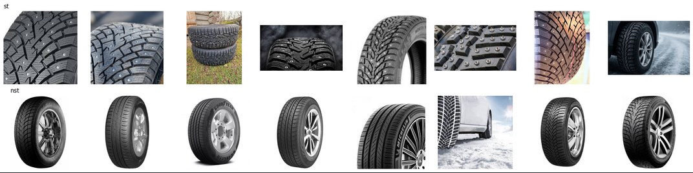
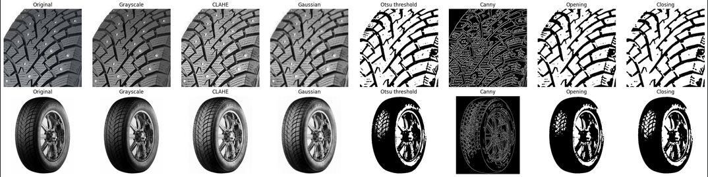
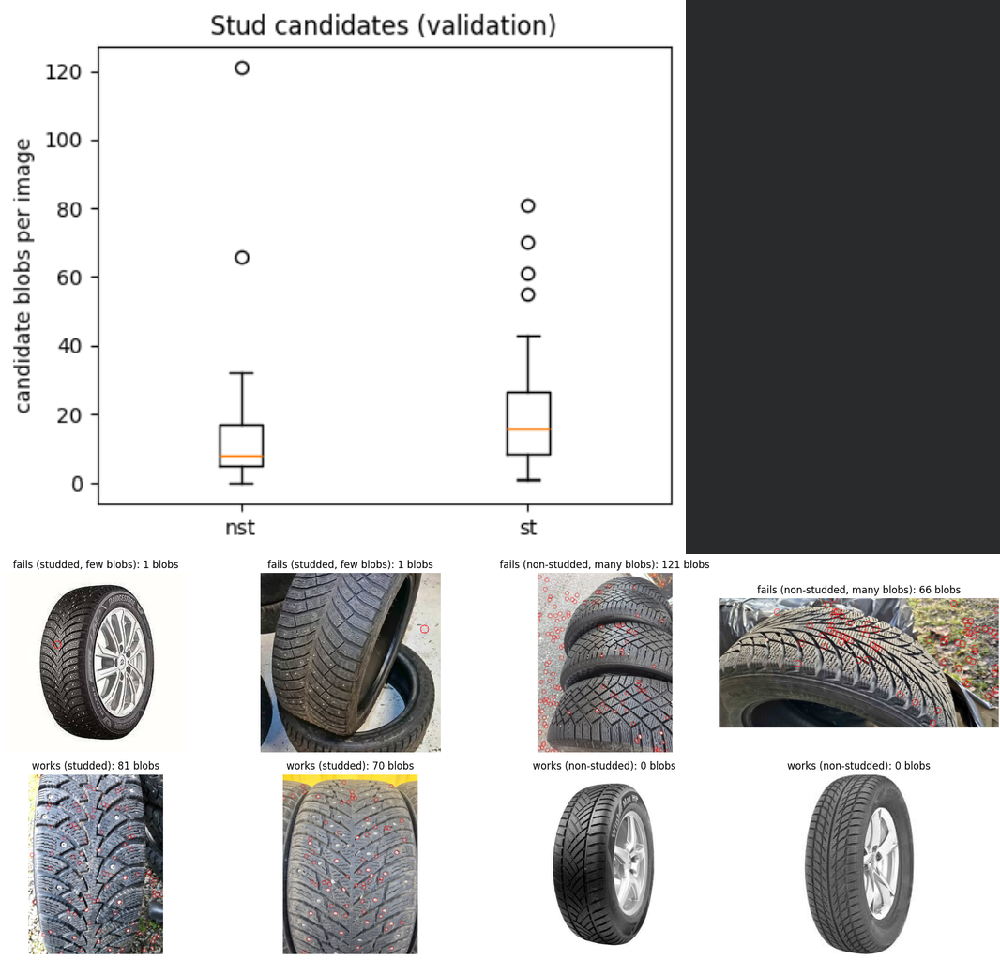
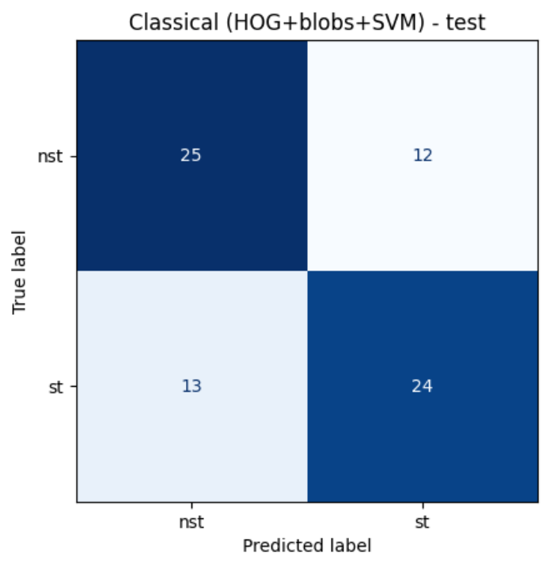
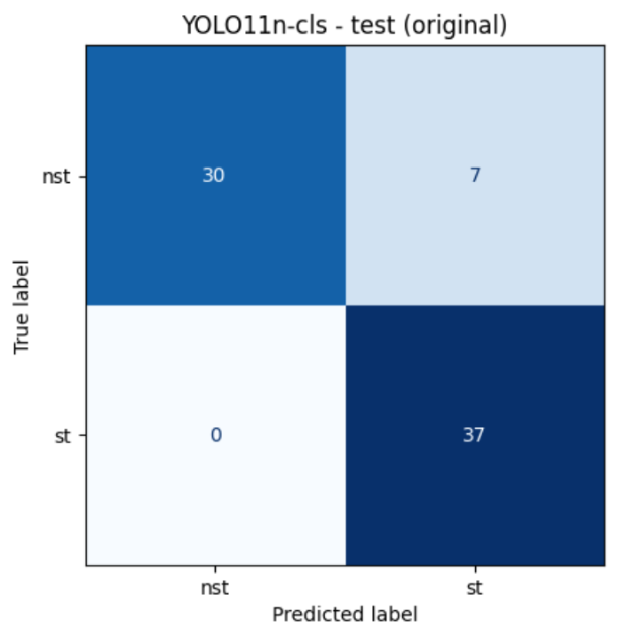
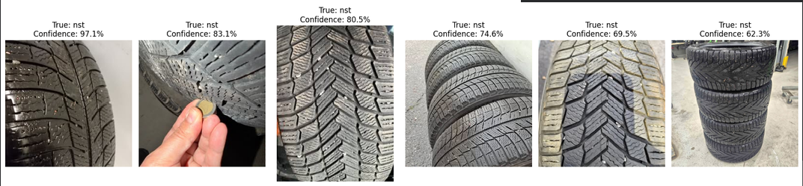
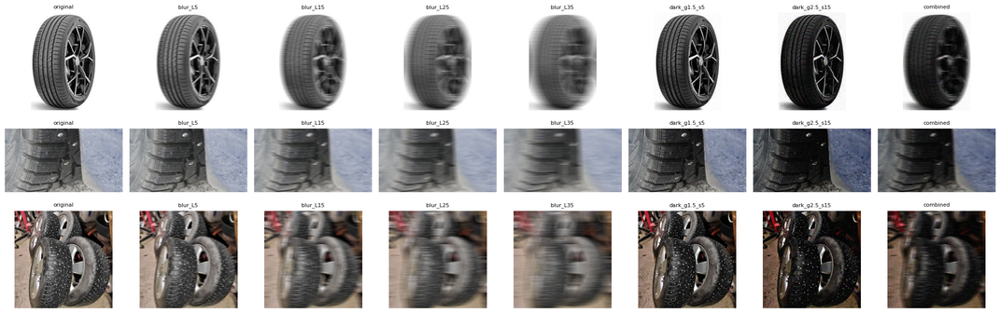
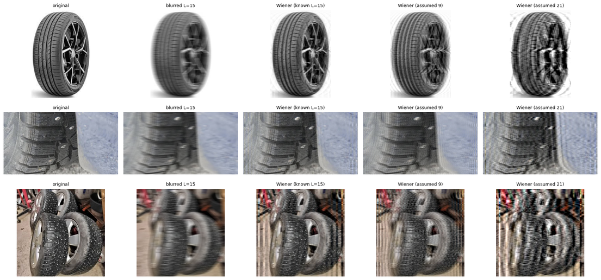
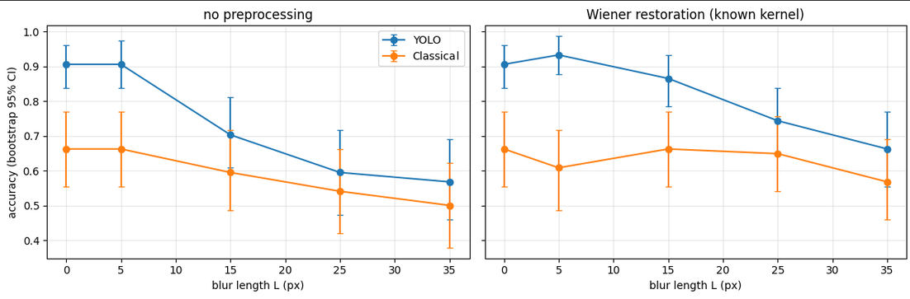
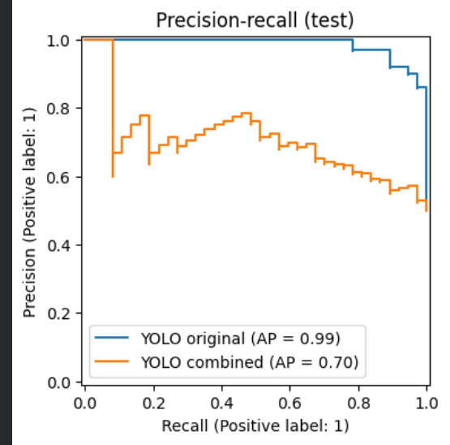

# LAB 11 – Image Processing and AI-Based Tire Classification

## Objective

The goal is to classify studded (st) and non-studded (nst) tires and compare two classifiers under different image conditions.

## Part 0 – Setup and data audit

The dataset contains 500 images: 350 training, 76 validation and 74 test images. Both classes are balanced. I used random seed 42. Different angles, distances, lighting and tread patterns make the task difficult.

## Part 1 – Classical image processing

I used grayscale, CLAHE, Gaussian filtering, Otsu thresholding, Canny, opening and closing. For the stud detector, I used top-hat, thresholding, connected components, and size, brightness and shape filters.

Final settings: top-hat = 25, threshold = 80, area = 10–100 pixels, brightness = 160, aspect ratio ≥ 0.6 and area ratio ≥ 0.5.

The median number of candidates is about 8 for nst and 16 for st. Bright studs are easier to detect, but small studs can be missed. Tread patterns and backgrounds can cause false detections.

## Parts 2 and 3 – Classical classifier and YOLO

I trained an SVM using HOG and four blob features. I selected C = 10 because it reached 71.05% validation accuracy. The pretrained YOLO11n-cls model was not changed.

| Test results | Classical | YOLO |
|---|---:|---:|
| Accuracy | 66.2% | 90.5% |
| Precision (st) | 66.7% | 84.1% |
| Recall (st) | 64.9% | 100% |
| F1-score (st) | 65.8% | 91.4% |
| CPU time/image | 11.1 ms | 19.2 ms |

All six most confident wrong YOLO predictions are non-studded tires. Complex tread patterns, holes and bright spots could be confused with studs.

## Parts 4 and 5 – Degradation and restoration

I simulated motion blur, low light and Gaussian noise. I used Wiener restoration for blur and inverse gamma, denoising and CLAHE for low light. K = 0.01 gave the highest validation PSNR (22.498 dB). Wrong kernels (L = 9 and 21) caused repeated edges and artefacts.

| Condition | PSNR before → after (dB) | SSIM before → after |
|---|---:|---:|
| L5 | 23.896 → 27.725 | 0.759 → 0.922 |
| L15 | 19.726 → 22.303 | 0.461 → 0.740 |
| L25 | 18.492 → 20.048 | 0.376 → 0.624 |
| L35 | 17.784 → 18.800 | 0.335 → 0.548 |
| Low light 1 | 18.579 → 19.397 | 0.836 → 0.830 |
| Low light 2 | 12.187 → 15.340 | 0.420 → 0.580 |
| Combined | 12.630 → 12.353 | 0.250 → 0.302 |

Higher PSNR does not always mean better classification.

## Part 6 – Robustness experiment

Test accuracy (%):

| Condition | Classical none | CLAHE | Restore | YOLO none | CLAHE | Restore |
|---|---:|---:|---:|---:|---:|---:|
| Original | 66.2 | 63.5 | – | 90.5 | 87.8 | – |
| L5 | 66.2 | 66.2 | 60.8 | 90.5 | 85.1 | 93.2 |
| L15 | 59.5 | 59.5 | 66.2 | 70.3 | 67.6 | 86.5 |
| L25 | 54.1 | 54.1 | 64.9 | 59.5 | 59.5 | 74.3 |
| L35 | 50.0 | 51.4 | 56.8 | 56.8 | 59.5 | 66.2 |
| Low light 1 | 63.5 | 60.8 | 60.8 | 86.5 | 85.1 | 81.1 |
| Low light 2 | 56.8 | 58.1 | 58.1 | 77.0 | 87.8 | 75.7 |
| Combined | 58.1 | 58.1 | 55.4 | 66.2 | 58.1 | 64.9 |

Full results: [results.csv](data/results.csv), including precision, recall, F1-score and 95% confidence intervals (1000 bootstrap resamples).

Wiener improves YOLO for all blur lengths. CLAHE helps under strong low light. Neither improves YOLO accuracy in the combined condition. At L35 with CLAHE, classical precision is 100%, but recall is only 2.7%.

The confidence intervals do not overlap for original and L5 images without preprocessing, original images with CLAHE, L5 and L15 with Wiener, mild low light without preprocessing, and both low-light conditions with CLAHE when comparing YOLO and classical. For stronger blur and combined images, the intervals overlap, so the differences are less clear.

## Part 7 – Decision threshold

I selected T = 0.476 on the validation set with a target precision of 95%. On the original test images, precision was only 84.1%. Average precision (AP) was 0.99 for original images and 0.70 for combined images.

## Bonus – Challenge Track

| Pipeline | Combined validation accuracy |
|---|---:|
| CLAHE | 57.9% |
| Gamma + CLAHE | 55.3% |
| Gamma + Wiener | 65.8% |

I selected gamma correction (0.7) and Wiener restoration (L = 15, K = 0.01). The hidden test accuracy is unknown.

## Engineering Recommendation Memo

**To:** City Council  
**Subject:** Studded Tire Classification System

### Recommended system

I would recommend a hybrid system that uses YOLO together with classical image processing when needed. On the original test images, YOLO reached 90.5% accuracy, while the classical classifier reached only 66.2%. YOLO detected all 37 studded tires correctly, but seven non-studded tires were wrongly classified as studded.

Our experiments showed that image processing can help YOLO. At a blur length of 15 pixels, Wiener restoration improved accuracy from 70.3% to 86.5%. Under strong low light, CLAHE improved accuracy from 77.0% to 87.8%. However, preprocessing does not always improve the results. The system would need to check the image conditions before choosing a filter.

### Decision threshold

In my opinion, a false positive is worse than a false negative. A false positive means that an innocent driver could get a fine. A false negative means that a studded tire is not detected. Because of this, I think precision is especially important.

We selected a threshold of 0.476 on the validation set with a precision target of 95%. However, the precision on the original test images was only 84.1%. The precision-recall curve also shows that average precision dropped from 0.99 to 0.70 under the combined condition. I would recommend a human check before a driver gets a fine.

### Reliability

Both classifiers perform worse as blur increases. Without restoration, YOLO accuracy drops to 70.3% at 15 pixels and to 59.5% at 25 pixels. With restoration, accuracy at 25 pixels is still only 74.3%. I think this is too low for a reliable control system. The real blur kernel may also be unknown.

Strong low light makes classification harder, although CLAHE can help. The combined condition is especially difficult because the images are dark, blurry and noisy. YOLO reached around 66% accuracy in this condition.

### Processing speed

YOLO needed 19.2 ms per image, while the classical classifier needed 11.1 ms. YOLO is slower, but the measured time corresponds to about 52 images per second. This is a promising result for real-time processing. However, the tests were done on the Colab CPU. We still need to measure the speed on a real edge device and include the time for preprocessing.

### Additional data

I would collect more pictures from real roadside cameras at night, during snowfall and rain, and of cars driving at different speeds. I would also collect pictures from different distances and angles, with different tire types and tread patterns. Our test set contains only 74 images. A larger independent test set would help us understand how reliable the system is in real situations before using it for fines.

## How to run

Open the notebook in Google Colab, use the CPU runtime, set the dataset and model paths in CONFIG and run the cells from top to bottom. Keep the original data and model unchanged. The notebook creates the separate data folders and results file.
