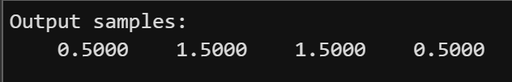

# MATLAB Assignment on Z Transform and Sample Delays

 ## Part 1:

  ### 1. Identify the sample represented by each term in X(z).

  X(z)=1*z^-0 + 2*z^−1 + 1*z^−2

  ### 2. Write the Z-transform of the delayed signal.

  X_delayed (z) = z^-1 + 2*z^-2 + z^-3

  

  ### 3. Explain why delaying the signal by one sample multiplies X(z) by z⁻¹.
  When we delay a signal by k samples, each sample moves to the direction. And to multiply X(z) by z^-k produces the exact same shift. And that increases the index by k.

 ## Part 2

  ###  4. Calculate y[0], y[1], y[2] and y[3] by hand. Compare them with MATLAB.

  y[n]=0.5x[n]+0.5x[n−1]

  y[0]=0.5x[0]+0.5x[−1] = y[0]=0.5*1 + 0.5*0 = 0.5
  y[1]=0.5x[1]+0.5x[0] =y[1]=0.5*2 + 0.5*1 = 1.5
  y[2]=0.5x[2]+0.5x[1] = y[2]=0.5*1 + 0.5*2 = 1.5
  y[3]=0.5x[3]+0.5x[2] = y[3]=0.5*0 + 0.5*1 = 0.5

  

  ### 5. Explain how b = [0.5 0.5] represents the two terms in H(z).
  Vector b is [0.5 0.5] which means both coefficients of H(z). The first one is 0.5 and is representing  our input sample x[n] and the second one represents x[n-1]. It is delayed by one sample. Because both are 0.5 they have the same influence on the output.

  

  ### 6. Change the system to H(z) = 0.8 + 0.2z⁻¹. Update b, run the code again, and explain which input sample now has more influence on the output.
  Now the first coefficient (0.8) of H(z) is larger and has more influence on the output than the second one (0.2). That means that x[n] has more influence than x[n-1]. But it is still an average filter, the difference is that the influence isn't the same anymore. It is weighted.

  